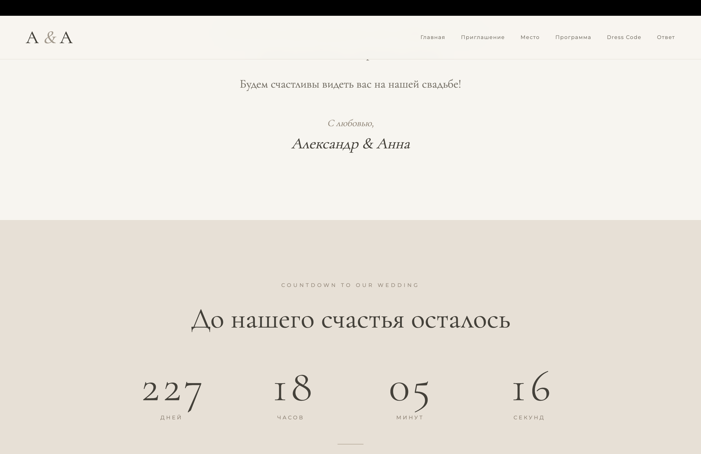

# Elegant Wedding Invitation Website 💍

A _modern_ and _elegant_ wedding invitation website built with React. The application provides a beautiful digital invitation where guests can explore wedding details, view the event schedule, find the venue, and confirm their attendance.

## 🚀 Live Demo

**Live Demo**: [ Elegant Web invitation URL](https://elegant-invitation-xi.vercel.app/)

Repository: [GitHub repository URL](https://github.com/DaddySammyLabs/elegant-invitation)

## 📸 Preview





## 📱 Mobile App

The project also includes a dedicated mobile version of the sneaker store.

The mobile app adapts the main shopping experience for mobile devices and provides users with convenient access to the catalog, favorites, shopping cart, orders, and other core features.

The mobile version was created to practice building a consistent user experience across different platforms while keeping the application architecture and business logic reusable.

---

## 🛠️ Tech Stack

### ⚛️ Core

- **React**
- **JavaScript (ES6+)**
- **Vite**
- **React Router**

### 🎨 Styling

- **Tailwind CSS**
- **CSS Modules**
- **Global CSS**

### 🧠 State & Logic

- **React Hooks**
- **Context API**
- **Custom Hooks**

### 📦 Libraries

- **@formkit/auto-animate**

---

### Elegant Wedding

#F8F5F0

Beige
#E9E0D5

Taupe
#B5A694

Olive
#747B68

Dark
#34332F

## 🧠 Architecture

```
src/
├── components/
│   ├── Header/
│   │   ├── Header.jsx
│   │   └── Header.module.css
│   ├── Hero/
│   │   ├── Hero.jsx
│   │   └── Hero.module.css
│   ├── Invitation/
│   ├── Timer/
│   ├── Location/
│   ├── Program/
│   ├── DressCode/
│   ├── RSVP/
│   └── Footer/
│
├── pages/
│   ├── Home.jsx
│   └── Home.module.css
│
├── App.jsx
└── main.jsx
```

## 🌐 Multilingual Support

The application supports multiple languages.

Text content is stored separately in:

src/constants/texts.js

Language-related functionality is located in the providers directory.

This approach keeps text content separated from UI components and makes adding additional languages easier.

## 🧭 Routing

The application uses React Router for client-side navigation.

### 💻 Installation

Clone the repository:

git clone https://github.com/your-username/react-sneaker-store.git

Navigate to the project:

`cd invitation-wedding`

Install dependencies:

`npm install`

Start the development server:

`npm run dev`

Build the project for production:

`npm run build`

## React Compiler

## Expanding the ESLint configuration
